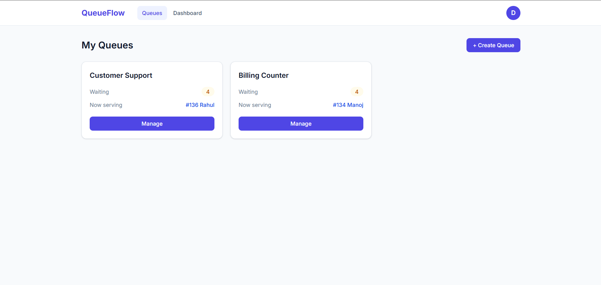
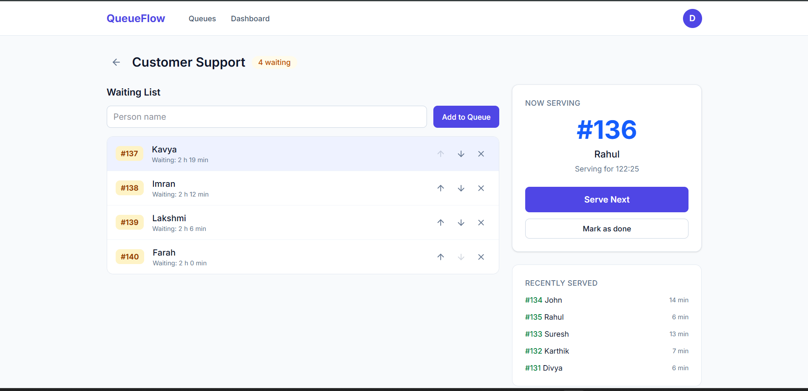
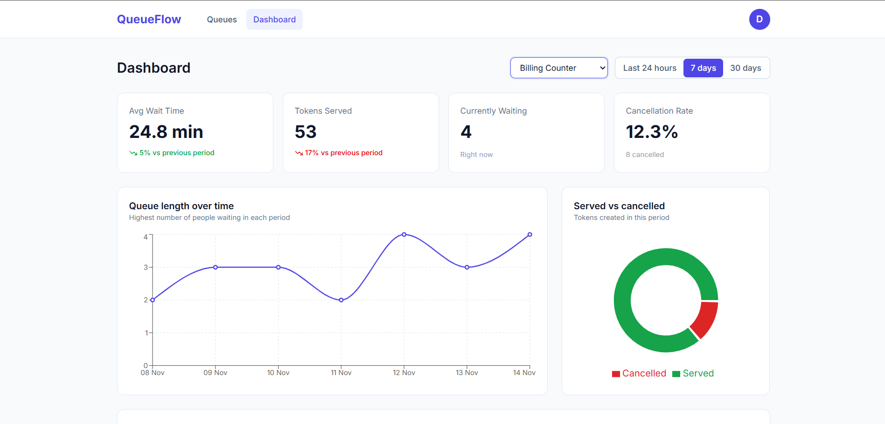
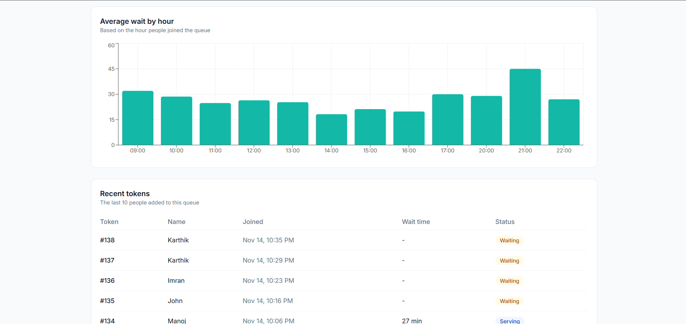

# QueueFlow

A queue management app where a manager can create queues, add people, change their order, serve the next token and see wait time analytics.

**Live demo:** https://queueflow-six.vercel.app
**Demo login:** demo@queueflow.com / demo1234

The server runs on a free plan and sleeps when idle, so the first load can take up to a minute.

## Screenshots

## Features

- Manager register and login with JWT
- Create queues with a name
- Add people, a token number is created for each one
- Move tokens up and down
- Serve the top token with one click
- Cancel a token
- Dashboard with average wait time, queue length trend, wait by hour and served vs cancelled

## Tech stack

- React (Vite), Tailwind CSS, Recharts
- Node.js, Express
- PostgreSQL with Prisma

## Run locally

You need Node 20 or newer and a PostgreSQL database.

1. Clone the repo

   git clone https://github.com/SanathRai33/QueueFlow.git
   cd queueflow

2. Server

   cd server
   npm install
   cp .env.example .env
   npx prisma migrate dev
   npm run seed
   npm run dev

3. Client (in another terminal)

   cd client
   npm install
   cp .env.example .env
   npm run dev

Open http://localhost:5173

## Environment variables

Server (`server/.env`)

| Name | Purpose |
|---|---|
| PORT | Port for the API, default 5000 |
| DATABASE_URL | PostgreSQL connection string |
| JWT_SECRET | Secret used to sign login tokens |
| CLIENT_URL | Origin allowed by CORS |

Client (`client/.env`)

| Name | Purpose |
|---|---|
| VITE_API_URL | Base URL of the API, for example http://localhost:5000/api |

## API

| Method | Endpoint | Purpose |
|---|---|---|
| POST | /api/auth/register | Create a manager |
| POST | /api/auth/login | Login |
| GET | /api/auth/me | Current manager |
| GET, POST | /api/queues | List and create queues |
| GET | /api/queues/:id | Queue with waiting, serving and recently served |
| GET, POST | /api/queues/:id/tokens | List waiting and add a token |
| POST | /api/queues/:id/serve-next | Serve the top token |
| POST | /api/queues/:id/complete-current | Mark the serving token as done |
| PATCH | /api/tokens/:id/move | Move up or down |
| PATCH | /api/tokens/:id/cancel | Cancel a token |
| GET | /api/analytics/queues/:id | Analytics for a queue |

## Design notes

- Token number never changes, position changes when tokens move
- Add, move, serve and cancel run in transactions with a row lock on the queue
- Cancelled tokens are kept with a status, so cancellation rate can be calculated
- Queue length snapshots are saved when the waiting count changes